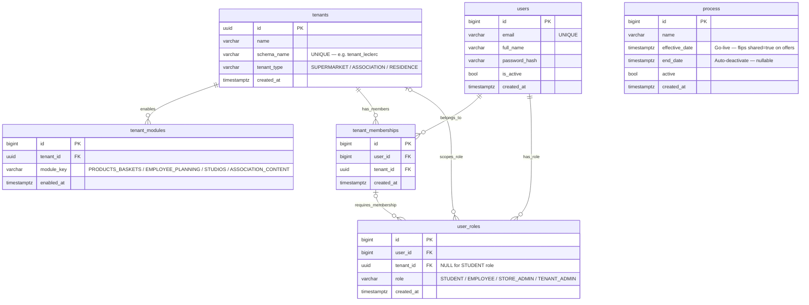
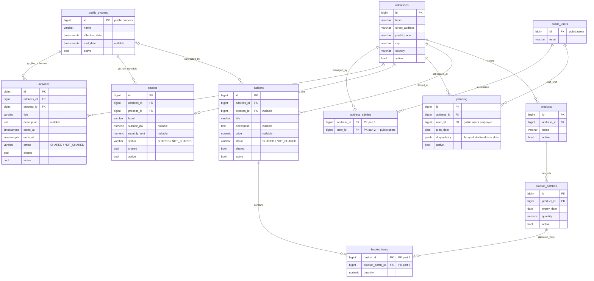

# Student Marketplace — Live Database Schema

> Introspected from `student_marketplace` · 2026-10-11  
> Connection: `postgresql://app_rls@127.0.0.1:5432/student_marketplace`  
> Schemas covered: **`public`** (shared identity) + **`tenant_*` template** (identical DDL in `tenant_leclerc`, `tenant_entraide`, `tenant_campus`).

---

## Diagram 1 — `public` schema

Identity, tenancy, roles, and scheduling all live here.  
`process` is referenced by offers in every tenant schema (no FK from `public` points to it).

### `has_role` — live constraints on `user_roles`

| Constraint | Definition |
|------------|------------|
| `user_roles_role_check` | `role IN ('STUDENT','EMPLOYEE','STORE_ADMIN','TENANT_ADMIN')` |
| `user_roles_tenant_scope_check` | `STUDENT → tenant_id IS NULL`; all others → `tenant_id IS NOT NULL` |
| `fk_role_membership` | Composite FK `(user_id, tenant_id) → tenant_memberships(user_id, tenant_id)` |
| `unique_global_student_role` | Partial unique on `(user_id, role) WHERE tenant_id IS NULL` — one STUDENT role per user |
| `unique_tenant_admin_per_user` | Partial unique on `(user_id) WHERE role = 'TENANT_ADMIN'` — at most one admin per user |
| `user_roles_user_id_tenant_id_role_key` | `UNIQUE (user_id, tenant_id, role)` |

---

## Diagram 2 — `tenant_*` schema template

`public_users` and `public_process` are cross-schema references (`public.users`, `public.process`).  
All three tenant schemas share this exact table structure; only seed data differs.

### Module gating

Tables are only created in a tenant schema when the matching module is enabled in `public.tenant_modules`:

| Module key | Tables created |
|------------|----------------|
| _(always)_ | `addresses`, `address_admins` |
| `PRODUCTS_BASKETS` | `products`, `product_batches`, `baskets`, `basket_items` |
| `EMPLOYEE_PLANNING` | `planning` |
| `STUDIOS` | `studios` |
| `ASSOCIATION_CONTENT` | `activities` |

### Offer lifecycle

1. Admin creates a `public.process` row (`effective_date`, `end_date`, `active = true`).
2. Admin creates the offer (`basket` / `studio` / `activity`) with `process_id`, `shared = false`, `status = 'NOT_SHARED'`, `active = true`.
3. Scheduled job: `effective_date ≤ now()` → flip `shared = true`, `status = 'SHARED'`; `end_date ≤ now()` → flip `active = false`, `shared = false`.
4. Student feed: `WHERE shared = true AND active = true`.

---

<strong>Full column &amp; constraint reference (introspected 2026-10-11)</strong>

### `public` schema

#### `public.tenants`

| Column | Type | Nullable |
|--------|------|----------|
| `id` | uuid | NOT NULL |
| `name` | varchar | NOT NULL |
| `schema_name` | varchar | NOT NULL |
| `created_at` | timestamptz | NOT NULL |
| `tenant_type` | varchar | nullable |

**Constraints:**
- `PK` `tenants_pkey` — `(id)`
- `UNIQUE` `tenants_schema_name_key` — `(schema_name)`
- `CHECK` `tenants_tenant_type_check` — `tenant_type IN ('SUPERMARKET','ASSOCIATION','RESIDENCE')`

---

#### `public.tenant_modules`

| Column | Type | Nullable |
|--------|------|----------|
| `id` | bigint | NOT NULL |
| `tenant_id` | uuid | NOT NULL |
| `module_key` | varchar | NOT NULL |
| `enabled_at` | timestamptz | NOT NULL |

**Constraints:**
- `PK` `tenant_modules_pkey` — `(id)`
- `UNIQUE` `tenant_modules_tenant_id_module_key_key` — `(tenant_id, module_key)`
- `FK` `tenant_modules_tenant_id_fkey` — `tenant_id → public.tenants(id) ON DELETE CASCADE`
- `CHECK` `tenant_modules_module_key_check` — `module_key IN ('PRODUCTS_BASKETS','EMPLOYEE_PLANNING','STUDIOS','ASSOCIATION_CONTENT')`

---

#### `public.users`

| Column | Type | Nullable |
|--------|------|----------|
| `id` | bigint | NOT NULL |
| `email` | varchar | NOT NULL |
| `full_name` | varchar | NOT NULL |
| `password_hash` | varchar | NOT NULL |
| `is_active` | bool | NOT NULL |
| `created_at` | timestamptz | NOT NULL |

**Constraints:**
- `PK` `users_pkey` — `(id)`
- `UNIQUE` `users_email_key` — `(email)`

---

#### `public.tenant_memberships`

| Column | Type | Nullable |
|--------|------|----------|
| `id` | bigint | NOT NULL |
| `user_id` | bigint | NOT NULL |
| `tenant_id` | uuid | NOT NULL |
| `created_at` | timestamptz | NOT NULL |

**Constraints:**
- `PK` `tenant_memberships_pkey` — `(id)`
- `UNIQUE` `tenant_memberships_user_id_tenant_id_key` — `(user_id, tenant_id)`
- `FK` `tenant_memberships_user_id_fkey` — `user_id → public.users(id) ON DELETE CASCADE`
- `FK` `tenant_memberships_tenant_id_fkey` — `tenant_id → public.tenants(id) ON DELETE CASCADE`

---

#### `public.user_roles`

| Column | Type | Nullable |
|--------|------|----------|
| `id` | bigint | NOT NULL |
| `user_id` | bigint | NOT NULL |
| `tenant_id` | uuid | nullable |
| `role` | varchar | NOT NULL |
| `created_at` | timestamptz | NOT NULL |

**Constraints:**
- `PK` `user_roles_pkey` — `(id)`
- `UNIQUE` `user_roles_user_id_tenant_id_role_key` — `(user_id, tenant_id, role)`
- `FK` `user_roles_user_id_fkey` — `user_id → public.users(id) ON DELETE CASCADE`
- `FK` `user_roles_tenant_id_fkey` — `tenant_id → public.tenants(id) ON DELETE CASCADE`
- `FK` `fk_role_membership` — `(user_id, tenant_id) → public.tenant_memberships(user_id, tenant_id)`
- `CHECK` `user_roles_role_check` — `role IN ('STUDENT','EMPLOYEE','STORE_ADMIN','TENANT_ADMIN')`
- `CHECK` `user_roles_tenant_scope_check` — `(role='STUDENT' AND tenant_id IS NULL) OR (role<>'STUDENT' AND tenant_id IS NOT NULL)`

**Partial indexes:**
- `unique_global_student_role` — `UNIQUE (user_id, role) WHERE tenant_id IS NULL`
- `unique_tenant_admin_per_user` — `UNIQUE (user_id) WHERE role = 'TENANT_ADMIN'`

---

#### `public.process`

| Column | Type | Nullable |
|--------|------|----------|
| `id` | bigint | NOT NULL |
| `name` | varchar | NOT NULL |
| `effective_date` | timestamptz | NOT NULL |
| `end_date` | timestamptz | nullable |
| `active` | bool | NOT NULL |
| `created_at` | timestamptz | NOT NULL |

**Constraints:**
- `PK` `process_pkey` — `(id)`

---

### `tenant_*` schemas

> The DDL below describes `tenant_leclerc`. `tenant_entraide` and `tenant_campus` have the same structure; only the enabled modules (and thus which tables exist) differ per tenant.

#### `tenant_*.addresses`

| Column | Type | Nullable |
|--------|------|----------|
| `id` | bigint | NOT NULL |
| `label` | varchar | NOT NULL |
| `street_address` | varchar | NOT NULL |
| `postal_code` | varchar | NOT NULL |
| `city` | varchar | NOT NULL |
| `country` | varchar | NOT NULL |
| `active` | bool | NOT NULL |

**Constraints:**
- `PK` `addresses_pkey` — `(id)`

---

#### `tenant_*.address_admins`

| Column | Type | Nullable |
|--------|------|----------|
| `address_id` | bigint | NOT NULL |
| `user_id` | bigint | NOT NULL |

**Constraints:**
- `PK` `address_admins_pkey` — `(address_id, user_id)`
- `FK` `address_admins_address_id_fkey` — `address_id → tenant_*.addresses(id) ON DELETE CASCADE`
- `FK` `address_admins_user_id_fkey` — `user_id → public.users(id) ON DELETE CASCADE`

---

#### `tenant_*.products` _(module: PRODUCTS\_BASKETS)_

| Column | Type | Nullable |
|--------|------|----------|
| `id` | bigint | NOT NULL |
| `address_id` | bigint | NOT NULL |
| `name` | varchar | NOT NULL |
| `active` | bool | NOT NULL |

**Constraints:**
- `PK` `products_pkey` — `(id)`
- `FK` `products_address_id_fkey` — `address_id → tenant_*.addresses(id)`

---

#### `tenant_*.product_batches` _(module: PRODUCTS\_BASKETS)_

| Column | Type | Nullable |
|--------|------|----------|
| `id` | bigint | NOT NULL |
| `product_id` | bigint | NOT NULL |
| `expiry_date` | date | NOT NULL |
| `quantity` | numeric | NOT NULL |
| `active` | bool | NOT NULL |

**Constraints:**
- `PK` `product_batches_pkey` — `(id)`
- `FK` `product_batches_product_id_fkey` — `product_id → tenant_*.products(id)`

**Indexes:**
- `product_batches_product_expiry_*` — `(product_id, expiry_date)`

---

#### `tenant_*.baskets` _(module: PRODUCTS\_BASKETS)_

| Column | Type | Nullable |
|--------|------|----------|
| `id` | bigint | NOT NULL |
| `address_id` | bigint | NOT NULL |
| `process_id` | bigint | nullable |
| `title` | varchar | NOT NULL |
| `description` | text | nullable |
| `price` | numeric | nullable |
| `status` | varchar | NOT NULL |
| `shared` | bool | NOT NULL |
| `active` | bool | NOT NULL |

**Constraints:**
- `PK` `baskets_pkey` — `(id)`
- `FK` `baskets_address_id_fkey` — `address_id → tenant_*.addresses(id)`
- `FK` `baskets_process_id_fkey` — `process_id → public.process(id)`
- `CHECK` `baskets_status_check` — `status IN ('SHARED','NOT_SHARED')`

**Indexes:**
- `baskets_shared_active_*` — `(shared, active)` — student feed filter

---

#### `tenant_*.basket_items` _(module: PRODUCTS\_BASKETS)_

| Column | Type | Nullable |
|--------|------|----------|
| `basket_id` | bigint | NOT NULL |
| `product_batch_id` | bigint | NOT NULL |
| `quantity` | numeric | NOT NULL |

**Constraints:**
- `PK` `basket_items_pkey` — `(basket_id, product_batch_id)`
- `FK` `basket_items_basket_id_fkey` — `basket_id → tenant_*.baskets(id) ON DELETE CASCADE`
- `FK` `basket_items_product_batch_id_fkey` — `product_batch_id → tenant_*.product_batches(id)`

---

#### `tenant_*.planning` _(module: EMPLOYEE\_PLANNING)_

| Column | Type | Nullable |
|--------|------|----------|
| `id` | bigint | NOT NULL |
| `address_id` | bigint | NOT NULL |
| `user_id` | bigint | NOT NULL |
| `plan_date` | date | NOT NULL |
| `disponibility` | jsonb | NOT NULL |
| `active` | bool | NOT NULL |

**Constraints:**
- `PK` `planning_pkey` — `(id)`
- `FK` `planning_address_id_fkey` — `address_id → tenant_*.addresses(id)`
- `FK` `planning_user_id_fkey` — `user_id → public.users(id)`

---

#### `tenant_*.studios` _(module: STUDIOS)_

| Column | Type | Nullable |
|--------|------|----------|
| `id` | bigint | NOT NULL |
| `address_id` | bigint | NOT NULL |
| `process_id` | bigint | NOT NULL |
| `label` | varchar | NOT NULL |
| `surface_m2` | numeric | nullable |
| `monthly_rent` | numeric | nullable |
| `status` | varchar | NOT NULL |
| `shared` | bool | NOT NULL |
| `active` | bool | NOT NULL |

**Constraints:**
- `PK` `studios_pkey` — `(id)`
- `FK` `studios_address_id_fkey` — `address_id → tenant_*.addresses(id) ON DELETE CASCADE`
- `FK` `studios_process_id_fkey` — `process_id → public.process(id)`
- `CHECK` `studios_status_check` — `status IN ('SHARED','NOT_SHARED')`

---

#### `tenant_*.activities` _(module: ASSOCIATION\_CONTENT)_

| Column | Type | Nullable |
|--------|------|----------|
| `id` | bigint | NOT NULL |
| `address_id` | bigint | NOT NULL |
| `process_id` | bigint | NOT NULL |
| `title` | varchar | NOT NULL |
| `description` | text | nullable |
| `starts_at` | timestamptz | NOT NULL |
| `ends_at` | timestamptz | NOT NULL |
| `status` | varchar | NOT NULL |
| `shared` | bool | NOT NULL |
| `active` | bool | NOT NULL |

**Constraints:**
- `PK` `activities_pkey` — `(id)`
- `FK` `activities_address_id_fkey` — `address_id → tenant_*.addresses(id) ON DELETE CASCADE`
- `FK` `activities_process_id_fkey` — `process_id → public.process(id)`
- `CHECK` `activities_status_check` — `status IN ('SHARED','NOT_SHARED')`

