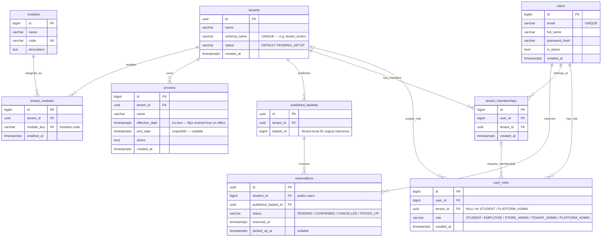
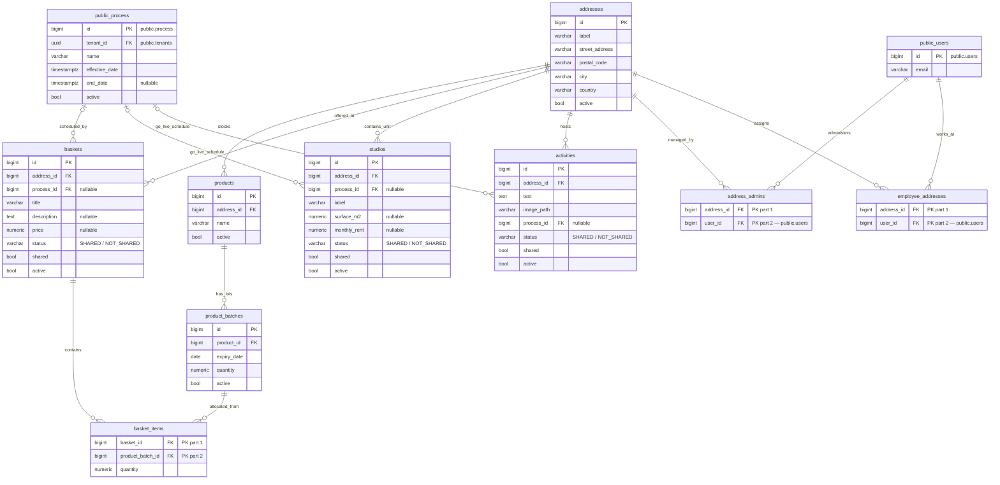

# Student Marketplace — Live Database Schema

> Target schema revised · 2026-10-30 · based on the 2026-10-11 introspection of `student_marketplace`\
> Connection: `postgresql://app_rls@127.0.0.1:5432/student_marketplace`\
> Schemas covered: **`public`** (shared identity, module catalog, publication references and reservations) + **`tenant_*` template** (tables depend on enabled modules).\
> Target architecture. [script.sql](docs/script.sql) installs only the public table structure and includes commented tenant/module templates; the lifecycle and access rules below remain specifications.

---

## Diagram 1 — `public` schema

Identity, tenancy, roles, the module catalog, scheduling and reservations all live here.\
Each `process` belongs to one tenant and can be reused by that tenant’s offers. `published_baskets` gives tenant-local baskets a global UUID for reservations.

### `has_role` — target constraints on `user_roles`

| Constraint | Definition |
|------------|------------|
| `user_roles_role_check` | `role IN ('STUDENT','EMPLOYEE','STORE_ADMIN','TENANT_ADMIN','PLATFORM_ADMIN')` |
| `user_roles_tenant_scope_check` | `STUDENT / PLATFORM_ADMIN → tenant_id IS NULL`; all others → `tenant_id IS NOT NULL` |
| `fk_role_membership` | Composite FK `(user_id, tenant_id) → tenant_memberships(user_id, tenant_id)` |
| `unique_global_role` | Partial unique on `(user_id, role) WHERE tenant_id IS NULL` — one assignment per global role per user |
| `unique_tenant_admin_per_user` | Partial unique on `(user_id) WHERE role = 'TENANT_ADMIN'` — at most one admin per user |
| `user_roles_user_id_tenant_id_role_key` | `UNIQUE (user_id, tenant_id, role)` |

---

## Diagram 2 — `tenant_*` schema template

`public_users` and `public_process` are cross-schema references (`public.users`, `public.process`).\
Tenant schemas use the same definitions for enabled modules; tables of modules that are not enabled are absent. In the user stories, a “store” is an `addresses` row and `store_admins` maps to `address_admins`.

### Module gating

Tables are only created in a tenant schema when the matching module is enabled in `public.tenant_modules`:

| Module key | Tables created | Publication with `process` |
|------------|----------------|----------------------------|
| _(always)_ | `addresses`, `address_admins`, `employee_addresses` | No |
| `PRODUCTS_BASKETS` | `products`, `product_batches`, `baskets`, `basket_items` | Yes, for baskets |
| `STUDIOS` | `studios` | Yes |
| `ACTIVITIES` | `activities` | Yes |

`public.modules` is the catalog; `public.tenant_modules.module_key` references its unique `code`. Registering a module does not implement its tables: activation runs that module’s migrations, creates the tenant schema if needed, and preserves existing data on repeated activation. `public.published_baskets` and `public.reservations` are shared tables, not duplicated per tenant.

### Offer lifecycle

1. An authorized Store Admin or Tenant Admin creates an offer (`basket` / `studio` / `activity`) with `process_id = NULL`, `shared = false`, `status = 'NOT_SHARED'`, `active = true`. A basket has a title, description, fixed price and composition; an activity contains only text and an image path besides its ownership and publication fields.
2. Admin selects an existing `public.process` of the same tenant or creates one (`tenant_id`, `name`, `effective_date`, optional `end_date`, `active = true`). The same process can schedule multiple offers; editing it requires permission for every affected establishment. No process means no automatic publication.
3. Scheduled job: publish only when the offer and process are active, `effective_date ≤ now()` and (`end_date IS NULL` or `now() < end_date`). Set `shared = true`, `status = 'SHARED'`. A basket must also contain usable lots from its own establishment with sufficient stock. Upsert its `public.published_baskets` reference using `(tenant_id, basket_id)`; reuse its UUID on repeated runs or republication.
4. At `end_date`, or if the offer/process becomes inactive (or the basket becomes unavailable), set `shared = false`, `status = 'NOT_SHARED'`. Publication expiry does not change the administrator’s `active` flag. Repeated jobs must be idempotent; never briefly publish an already expired process.
5. Student feed: require `shared = true AND active = true`, an active process within its publication window, and an enabled module. Basket availability is rechecked against current lots and stock. Students can read qualifying offers across tenants without membership, but cannot edit them. Keep publication references and reservation history after withdrawal; a reference alone does not mean an offer is currently visible.

**Application rules (not enforced by the simple FKs below):**

- Tenant Admins administer all addresses of their tenant. Store Admins only administer addresses assigned through `address_admins`; assignments require membership of that tenant and the `STORE_ADMIN` role. The `EMPLOYEE` role remains available, without a dedicated business module.
- Every offer’s process must belong to the tenant owning its schema. Reject cross-tenant process selection and unauthorized changes to a reused process. The FK on `process_id` alone does not enforce tenant ownership.
- Products and basket lots must belong to the selected establishment. Reject negative batch quantities, non-positive basket item quantities and expired (`expiry_date < CURRENT_DATE`), inactive or insufficient lots. A product remains available while at least one active, unexpired lot has stock. Require a fixed, non-negative price when creating a basket; the existing nullable column remains for legacy records.
- A reservation requires the global `STUDENT` role. Resolve its publication reference through the registered tenant schema, check that the basket is currently published and available, then create the reservation and engage all required lot quantities in one transaction. Serialize concurrent reservations against the same lots, including lots shared by different baskets, so stock cannot be oversold. This transaction and its access controls remain to be implemented; the structure-only script provides the tables and constraints.
- Students can read only their own reservations. Store Admins can read reservations for their assigned addresses, and Tenant Admins for their own tenant. Resolve the establishment via the publication reference and source basket; do not grant staff access merely because the reservation is in `public`.

---

<strong>Full column &amp; constraint reference (target revised 2026-10-30)</strong>

### `public` schema

#### `public.tenants`

| Column | Type | Nullable |
|--------|------|----------|
| `id` | uuid | NOT NULL |
| `name` | varchar | NOT NULL |
| `schema_name` | varchar | NOT NULL |
| `created_at` | timestamptz | NOT NULL |
| `status` | varchar | NOT NULL |

**Constraints:**

- `PK` `tenants_pkey` — `(id)`
- `UNIQUE` `tenants_schema_name_key` — `(schema_name)`

**Defaults:**

- `status = 'PENDING_SETUP'` on creation. Further onboarding states and transitions are not specified by the supplied stories.

---

#### `public.modules`

| Column | Type | Nullable |
|--------|------|----------|
| `id` | bigint | NOT NULL |
| `name` | varchar | NOT NULL |
| `code` | varchar | NOT NULL |
| `description` | text | NOT NULL |

**Constraints:**

- `PK` `modules_pkey` — `(id)`
- `UNIQUE` `modules_code_key` — `(code)`

**Initial catalog:** `PRODUCTS_BASKETS`, `STUDIOS`, `ACTIVITIES`. Platform Admins manage this catalog and module assignments; codes are not a fixed CHECK enumeration.

---

#### `public.tenant_modules`

| Column | Type | Nullable |
|--------|------|----------|
| `id` | bigint | NOT NULL |
| `tenant_id` | uuid | NOT NULL |
| `module_key` | varchar | NOT NULL |
| `enabled_at` | timestamptz | NOT NULL |

**Constraints:**

- `PK` `tenant_modules_pkey` — `(id)`
- `UNIQUE` `tenant_modules_tenant_id_module_key_key` — `(tenant_id, module_key)`
- `FK` `tenant_modules_tenant_id_fkey` — `tenant_id → public.tenants(id) ON DELETE CASCADE`
- `FK` `tenant_modules_module_key_fkey` — `module_key → public.modules(code)`

---

#### `public.users`

| Column | Type | Nullable |
|--------|------|----------|
| `id` | bigint | NOT NULL |
| `email` | varchar | NOT NULL |
| `full_name` | varchar | NOT NULL |
| `password_hash` | varchar | NOT NULL |
| `is_active` | bool | NOT NULL |
| `created_at` | timestamptz | NOT NULL |

**Constraints:**

- `PK` `users_pkey` — `(id)`
- `UNIQUE` `users_email_key` — `(email)`

---

#### `public.tenant_memberships`

| Column | Type | Nullable |
|--------|------|----------|
| `id` | bigint | NOT NULL |
| `user_id` | bigint | NOT NULL |
| `tenant_id` | uuid | NOT NULL |
| `created_at` | timestamptz | NOT NULL |

**Constraints:**

- `PK` `tenant_memberships_pkey` — `(id)`
- `UNIQUE` `tenant_memberships_user_id_tenant_id_key` — `(user_id, tenant_id)`
- `FK` `tenant_memberships_user_id_fkey` — `user_id → public.users(id) ON DELETE CASCADE`
- `FK` `tenant_memberships_tenant_id_fkey` — `tenant_id → public.tenants(id) ON DELETE CASCADE`

---

#### `public.user_roles`

| Column | Type | Nullable |
|--------|------|----------|
| `id` | bigint | NOT NULL |
| `user_id` | bigint | NOT NULL |
| `tenant_id` | uuid | nullable |
| `role` | varchar | NOT NULL |
| `created_at` | timestamptz | NOT NULL |

**Constraints:**

- `PK` `user_roles_pkey` — `(id)`
- `UNIQUE` `user_roles_user_id_tenant_id_role_key` — `(user_id, tenant_id, role)`
- `FK` `user_roles_user_id_fkey` — `user_id → public.users(id) ON DELETE CASCADE`
- `FK` `user_roles_tenant_id_fkey` — `tenant_id → public.tenants(id) ON DELETE CASCADE`
- `FK` `fk_role_membership` — `(user_id, tenant_id) → public.tenant_memberships(user_id, tenant_id)`
- `CHECK` `user_roles_role_check` — `role IN ('STUDENT','EMPLOYEE','STORE_ADMIN','TENANT_ADMIN','PLATFORM_ADMIN')`
- `CHECK` `user_roles_tenant_scope_check` — `(role IN ('STUDENT','PLATFORM_ADMIN') AND tenant_id IS NULL) OR (role IN ('EMPLOYEE','STORE_ADMIN','TENANT_ADMIN') AND tenant_id IS NOT NULL)`

**Partial indexes:**

- `unique_global_role` — `UNIQUE (user_id, role) WHERE tenant_id IS NULL`
- `unique_tenant_admin_per_user` — `UNIQUE (user_id) WHERE role = 'TENANT_ADMIN'`

---

#### `public.process`

| Column | Type | Nullable |
|--------|------|----------|
| `id` | bigint | NOT NULL |
| `tenant_id` | uuid | NOT NULL |
| `name` | varchar | NOT NULL |
| `effective_date` | timestamptz | NOT NULL |
| `end_date` | timestamptz | nullable |
| `active` | bool | NOT NULL |
| `created_at` | timestamptz | NOT NULL |

**Constraints:**

- `PK` `process_pkey` — `(id)`
- `FK` `process_tenant_id_fkey` — `tenant_id → public.tenants(id)`
- `CHECK` `process_dates_check` — `end_date IS NULL OR end_date > effective_date`

---

#### `public.published_baskets`

| Column | Type | Nullable |
|--------|------|----------|
| `id` | uuid | NOT NULL |
| `tenant_id` | uuid | NOT NULL |
| `basket_id` | bigint | NOT NULL |

**Constraints:**

- `PK` `published_baskets_pkey` — `(id)`
- `UNIQUE` `published_baskets_tenant_id_basket_id_key` — `(tenant_id, basket_id)`
- `FK` `published_baskets_tenant_id_fkey` — `tenant_id → public.tenants(id) ON DELETE RESTRICT`

**Reference and retention rules:**

- `basket_id` logically identifies `baskets(id)` in the schema registered by `tenant_id`. It is not a PostgreSQL FK: the destination schema varies by row. The publication workflow must validate the source basket and tenant when creating this reference; it is not installed by the structure-only script.
- This is a stable publication identity, not an offer snapshot or a stock counter. Preserve the reference and source basket/address after unpublishing; future deletion and module-removal workflows must prevent removal of source records required by reservation history. Preserve composition while stock is engaged, or implement an allocation history before allowing edits that would invalidate reservations.
- Actual availability comes from the source basket, its process, module and lots. Do not list all rows of this table as available offers.

---

#### `public.reservations`

| Column | Type | Nullable |
|--------|------|----------|
| `id` | uuid | NOT NULL |
| `student_id` | bigint | NOT NULL |
| `published_basket_id` | uuid | NOT NULL |
| `status` | varchar | NOT NULL |
| `reserved_at` | timestamptz | NOT NULL |
| `picked_up_at` | timestamptz | nullable |

**Constraints:**

- `PK` `reservations_pkey` — `(id)`
- `FK` `reservations_student_id_fkey` — `student_id → public.users(id) ON DELETE RESTRICT`
- `FK` `reservations_published_basket_id_fkey` — `published_basket_id → public.published_baskets(id) ON DELETE RESTRICT`
- `CHECK` `reservations_status_check` — `status IN ('PENDING','CONFIRMED','CANCELLED','PICKED_UP')`

**Defaults and semantics:**

- `status = 'PENDING'`, `reserved_at = now()`, `picked_up_at = NULL` when a reservation is created. One row reserves one basket; there is no reservation quantity column.
- `picked_up_at` records the actual collection time. Proposed confirmation, cancellation and pickup scenarios are listed separately in [User-Stories-LiveV1.md](User-Stories-LiveV1.md); those transition rules are not enforced by the status CHECK.
- The user FK establishes identity only. Student eligibility, ownership, staff permissions and atomic stock engagement follow the application rules above.

**Indexes:**

- `reservations_student_id_idx` — `(student_id)`
- `reservations_published_basket_id_idx` — `(published_basket_id)`

---

### `tenant_*` schemas

> The definitions below describe the target `tenant_*` template. Each tenant receives the common tables plus the tables for its enabled modules. `addresses.label` is the store name; `address_admins` supports multiple admins per store and multiple stores per admin.

#### `tenant_*.addresses`

| Column | Type | Nullable |
|--------|------|----------|
| `id` | bigint | NOT NULL |
| `label` | varchar | NOT NULL |
| `street_address` | varchar | NOT NULL |
| `postal_code` | varchar | NOT NULL |
| `city` | varchar | NOT NULL |
| `country` | varchar | NOT NULL |
| `active` | bool | NOT NULL |

**Constraints:**

- `PK` `addresses_pkey` — `(id)`

---

#### `tenant_*.address_admins`

| Column | Type | Nullable |
|--------|------|----------|
| `address_id` | bigint | NOT NULL |
| `user_id` | bigint | NOT NULL |

**Constraints:**

- `PK` `address_admins_pkey` — `(address_id, user_id)`
- `FK` `address_admins_address_id_fkey` — `address_id → tenant_*.addresses(id) ON DELETE CASCADE`
- `FK` `address_admins_user_id_fkey` — `user_id → public.users(id) ON DELETE CASCADE`

---

#### `tenant_*.employee_addresses`

| Column | Type | Nullable |
|--------|------|----------|
| `address_id` | bigint | NOT NULL |
| `user_id` | bigint | NOT NULL |

**Constraints:**

- `PK` `employee_addresses_pkey` — `(address_id, user_id)`
- `FK` `employee_addresses_address_id_fkey` — `address_id → tenant_*.addresses(id) ON DELETE CASCADE`
- `FK` `employee_addresses_user_id_fkey` — `user_id → public.users(id) ON DELETE CASCADE`

**Assignment rule:** The user must hold the tenant's `EMPLOYEE` role. This common table preserves employee-to-store assignments independently of any scheduling feature.

---

#### `tenant_*.products` _(module: PRODUCTS\_BASKETS)_

| Column | Type | Nullable |
|--------|------|----------|
| `id` | bigint | NOT NULL |
| `address_id` | bigint | NOT NULL |
| `name` | varchar | NOT NULL |
| `active` | bool | NOT NULL |

**Constraints:**

- `PK` `products_pkey` — `(id)`
- `FK` `products_address_id_fkey` — `address_id → tenant_*.addresses(id)`

---

#### `tenant_*.product_batches` _(module: PRODUCTS\_BASKETS)_

| Column | Type | Nullable |
|--------|------|----------|
| `id` | bigint | NOT NULL |
| `product_id` | bigint | NOT NULL |
| `expiry_date` | date | NOT NULL |
| `quantity` | numeric | NOT NULL |
| `active` | bool | NOT NULL |

**Constraints:**

- `PK` `product_batches_pkey` — `(id)`
- `FK` `product_batches_product_id_fkey` — `product_id → tenant_*.products(id)`
- `CHECK` `product_batches_quantity_check` — `quantity >= 0`

**Indexes:**

- `product_batches_product_expiry_*` — `(product_id, expiry_date)`

---

#### `tenant_*.baskets` _(module: PRODUCTS\_BASKETS)_

| Column | Type | Nullable |
|--------|------|----------|
| `id` | bigint | NOT NULL |
| `address_id` | bigint | NOT NULL |
| `process_id` | bigint | nullable |
| `title` | varchar | NOT NULL |
| `description` | text | nullable |
| `price` | numeric | nullable |
| `status` | varchar | NOT NULL |
| `shared` | bool | NOT NULL |
| `active` | bool | NOT NULL |

**Constraints:**

- `PK` `baskets_pkey` — `(id)`
- `FK` `baskets_address_id_fkey` — `address_id → tenant_*.addresses(id)`
- `FK` `baskets_process_id_fkey` — `process_id → public.process(id)`
- `CHECK` `baskets_status_check` — `status IN ('SHARED','NOT_SHARED')`
- `CHECK` `baskets_price_check` — `price >= 0` (NULL allowed for legacy records)

**Indexes:**

- `baskets_shared_active_*` — `(shared, active)` — student feed filter

---

#### `tenant_*.basket_items` _(module: PRODUCTS\_BASKETS)_

| Column | Type | Nullable |
|--------|------|----------|
| `basket_id` | bigint | NOT NULL |
| `product_batch_id` | bigint | NOT NULL |
| `quantity` | numeric | NOT NULL |

**Constraints:**

- `PK` `basket_items_pkey` — `(basket_id, product_batch_id)`
- `FK` `basket_items_basket_id_fkey` — `basket_id → tenant_*.baskets(id) ON DELETE CASCADE`
- `FK` `basket_items_product_batch_id_fkey` — `product_batch_id → tenant_*.product_batches(id)`
- `CHECK` `basket_items_quantity_check` — `quantity > 0`

---

#### `tenant_*.studios` _(module: STUDIOS)_

| Column | Type | Nullable |
|--------|------|----------|
| `id` | bigint | NOT NULL |
| `address_id` | bigint | NOT NULL |
| `process_id` | bigint | nullable |
| `label` | varchar | NOT NULL |
| `surface_m2` | numeric | nullable |
| `monthly_rent` | numeric | nullable |
| `status` | varchar | NOT NULL |
| `shared` | bool | NOT NULL |
| `active` | bool | NOT NULL |

**Constraints:**

- `PK` `studios_pkey` — `(id)`
- `FK` `studios_address_id_fkey` — `address_id → tenant_*.addresses(id) ON DELETE CASCADE`
- `FK` `studios_process_id_fkey` — `process_id → public.process(id)`
- `CHECK` `studios_status_check` — `status IN ('SHARED','NOT_SHARED')`

---

#### `tenant_*.activities` _(module: ACTIVITIES)_

| Column | Type | Nullable |
|--------|------|----------|
| `id` | bigint | NOT NULL |
| `address_id` | bigint | NOT NULL |
| `text` | text | NOT NULL |
| `image_path` | varchar | NOT NULL |
| `process_id` | bigint | nullable |
| `status` | varchar | NOT NULL |
| `shared` | bool | NOT NULL |
| `active` | bool | NOT NULL |

**Constraints:**

- `PK` `activities_pkey` — `(id)`
- `FK` `activities_address_id_fkey` — `address_id → tenant_*.addresses(id) ON DELETE CASCADE`
- `FK` `activities_process_id_fkey` — `process_id → public.process(id)`
- `CHECK` `activities_status_check` — `status IN ('SHARED','NOT_SHARED')`

